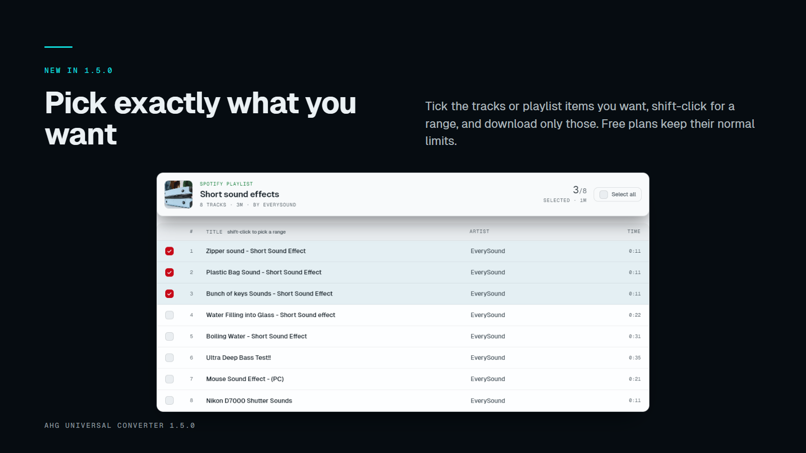
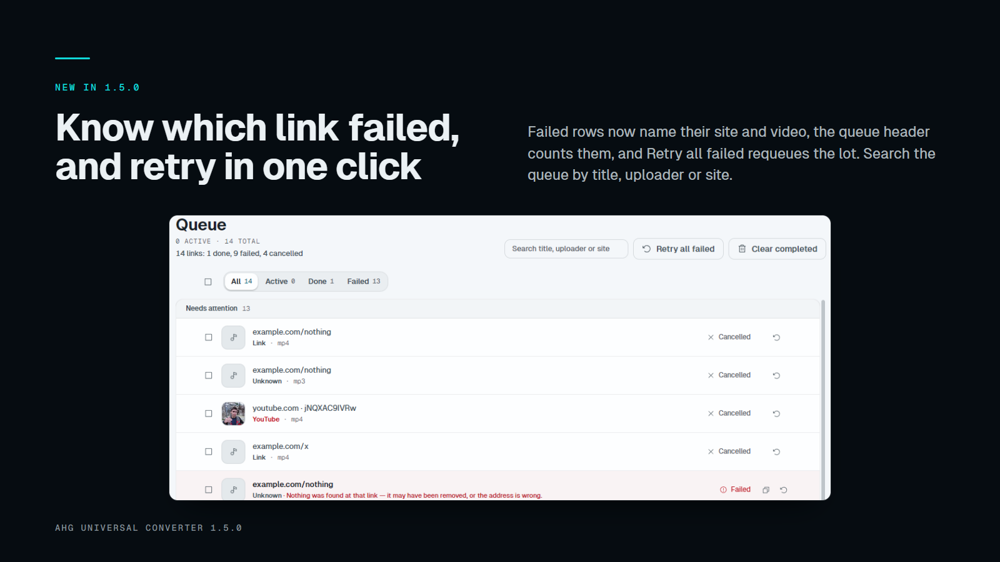
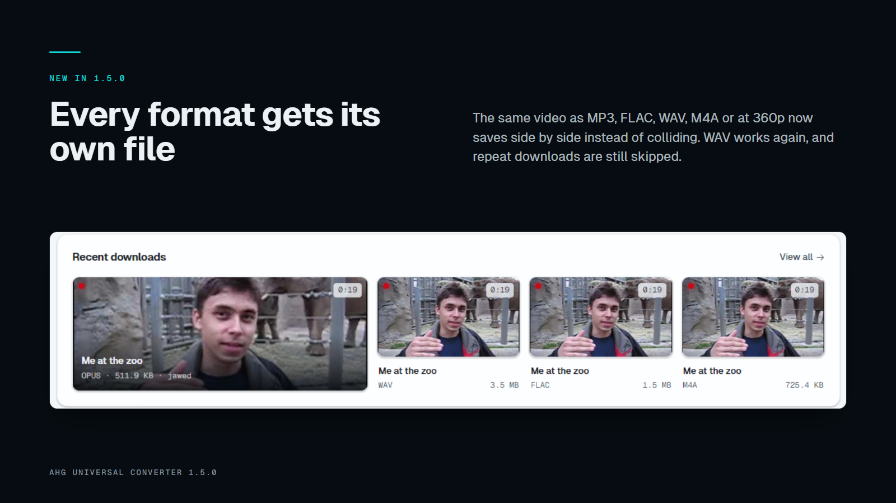
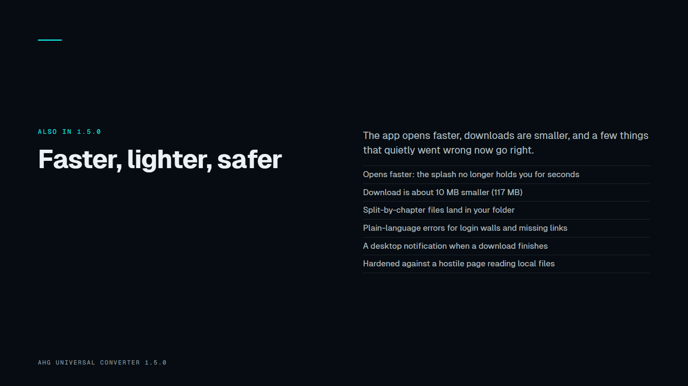
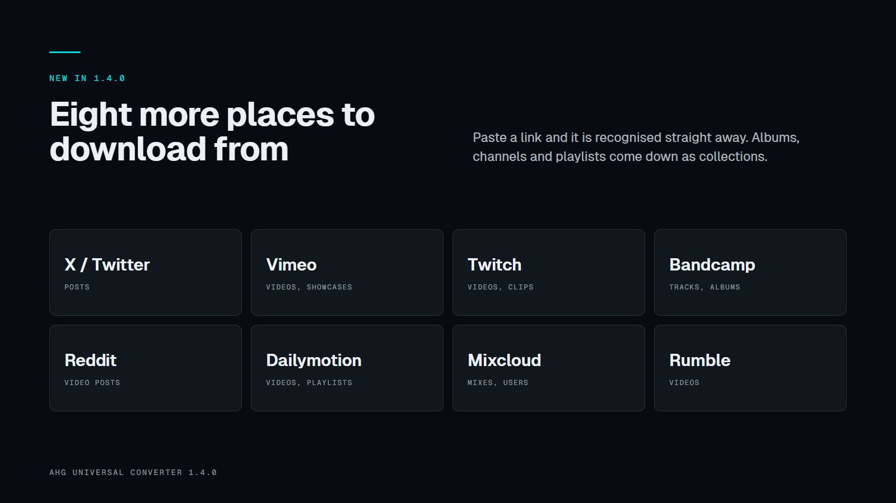
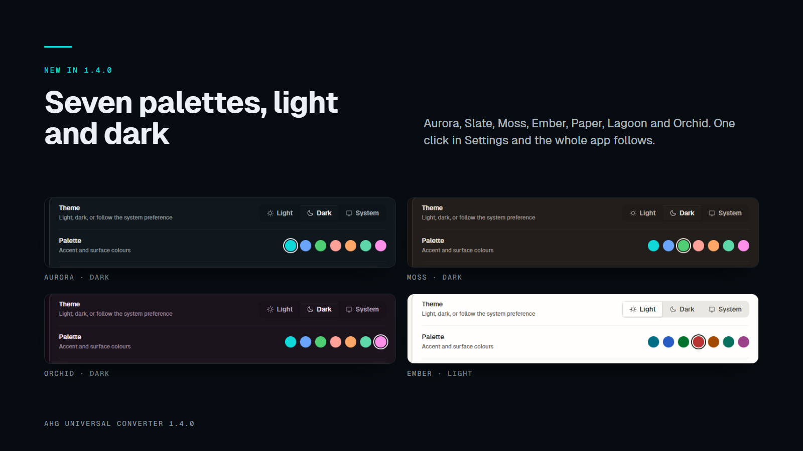
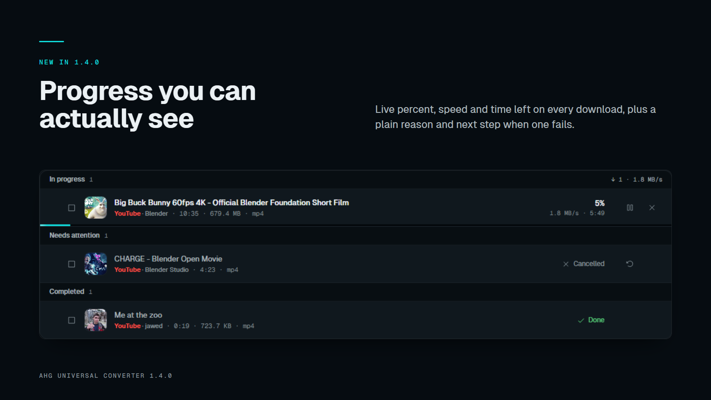

# AHG Universal Converter 1.5.0

**Pick what you download, see what failed, and get every format as its own file.**

## What's new

### Pick exactly what you want
Playlists and albums now have checkboxes: tick the items you want, shift-click for a range, and download only those as one job.

### Know which link failed
Failed and untitled rows now name their site and video instead of a row of identical "Untitled". The queue header counts your links ("14 links: 1 done, 9 failed"), there is a **Retry all failed** button, and a search box filters the queue by title, uploader or site. Unsupported links are rejected up front, and links that can never work no longer count down through three pointless retries.

### Every format gets its own file
The same video as MP3, FLAC, WAV, M4A, or at a specific resolution now saves side by side instead of one silently replacing or skipping another. Your usual choice (best-quality video, MP3 audio) keeps the exact name it always had, so **Skip existing** still recognises everything you already own. **WAV downloads now complete** (they were reported as failed even though the file was written).

### Also new
- **Split by chapter** files now land in your download folder (they were written to the app's own folder).
- **Plain-language errors** for sites that need a login and for links that no longer exist, instead of raw tool output.
- **A desktop notification** when a download finishes, and progress on the taskbar button.
- **Opens faster**: the start-up splash no longer holds you for seconds.
- **A smaller download**: the portable app is about 10 MB smaller (117 MB).
- **Cleaner colours**: Moss, Ember and Lagoon were re-tuned so each palette is clearly distinct, and the toggle knob reads properly in light mode. Text no longer goes below 11 px.
- **Safer**: a page can no longer read local files through the app window, only web links (http/https) are accepted, the output folder can't point at a system folder, and failures are logged with the site and reason (no links or secrets).
- Empty screens now show one message and one action instead of grey placeholder rows. The dead "auto-paste" toggle is gone.

## Not in this release
- Bundled JavaScript runtime for YouTube (works as before; a few high-quality formats may be unavailable).
- Extra hardening of the app shell and code signing (needs tooling not in place yet).
- A full preview step for the eight newer sources, and a stage label when video and audio download separately (the bar still restarts for the audio part).
- Cleaning up partial files when you cancel a download.
- Known: the Spotify search box can return nothing for some queries (pasting a Spotify link works).

---

# AHG Universal Converter 1.4.0

**Fewer failures, clearer failures, and a lot more places to download from.**

## What's new

### Eight more sources
Paste a link from **X (Twitter), Vimeo, Twitch, Bandcamp, Reddit, Dailymotion, Mixcloud or Rumble** and the app recognises it straight away. Bandcamp albums and artists, Vimeo showcases and channels, Twitch videos and clips, Mixcloud users and Dailymotion playlists download as a collection.

### Seven colour palettes
Settings → Appearance now has **Aurora, Slate, Moss, Ember, Paper, Lagoon and Orchid**, each in light and dark. Pick one and the whole app changes live, with no flash on the next start. Every pair of colours was checked for readable contrast.

### Live progress, and clearer failures
Every download now shows live percent, speed and time left. (Earlier versions waited on "Fetching" until the file was finished.) When a download fails you now see why, in plain words, and what to do next: private video, removed, age-restricted, sign-in needed, not available in your country, protected content, rate limited, no network, disk full. Failed rows have a **Copy details** button for support. Retrying rows say **"Retrying in 15s (2 of 3)"**. Things that can't succeed are no longer retried.

### Your own logged-in access
**Import cookies.txt** (Settings, Plus) lets downloads run as your own signed-in account, so private, members-only and age-gated videos you can already watch work.

### Live speed graph
While anything is downloading, the Dashboard shows a live **speed graph** and a pulsing status dot. It pauses when the window is hidden and stays still if you prefer reduced motion.

### Smoother, calmer motion
Progress bars glide, finished and failed badges pop in, buttons press, and loading placeholders shimmer. Everything honours your system's reduced-motion setting.

## Reliability and safety
- The app no longer repeats work on every progress tick, so busy queues stay light.
- History, stats, licence and settings are saved atomically, so a crash or power cut can't leave a half-written file.
- A small rotating log (`ahg.log`) records crashes and failures, with tokens and cookies removed.
- Folder, proxy and speed-limit settings are validated, and bad values are rejected with a reason.
- Updates only follow downloads that end on a trusted GitHub host, and must still match the published checksum.
- A cached licence stops working after 30 days offline.
- Bundled **yt-dlp updated to 2026.10.21**.
- Unused bot credentials were removed from the app.

## Not in this release
- **Bundled JS runtime for YouTube.** Skipped. YouTube works as before; some yt-dlp builds warn that a few formats may be missing.
- **Extra hardening of the app shell** (Electron fuses). Needs a newer build tool; planned for a later release.
- **Playlist item picking for YouTube.** The engine supports downloading chosen items, but there is no picker for it yet.
- **Icons for the eight new sources.** They have labels only for now.
- Bare Twitch channel links (live streams) are treated as single items, not collections.
- Known limits: on downloads that merge separate video and audio, the progress bar restarts when the audio part begins; the 30-day offline cap can be defeated by editing local files or the clock; cookies.txt files containing only HttpOnly cookies are rejected; a fresh install may flash the default palette for a moment on first launch.
