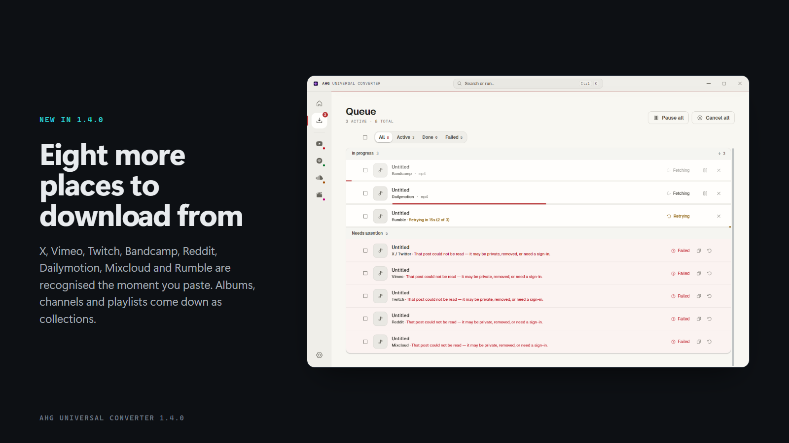
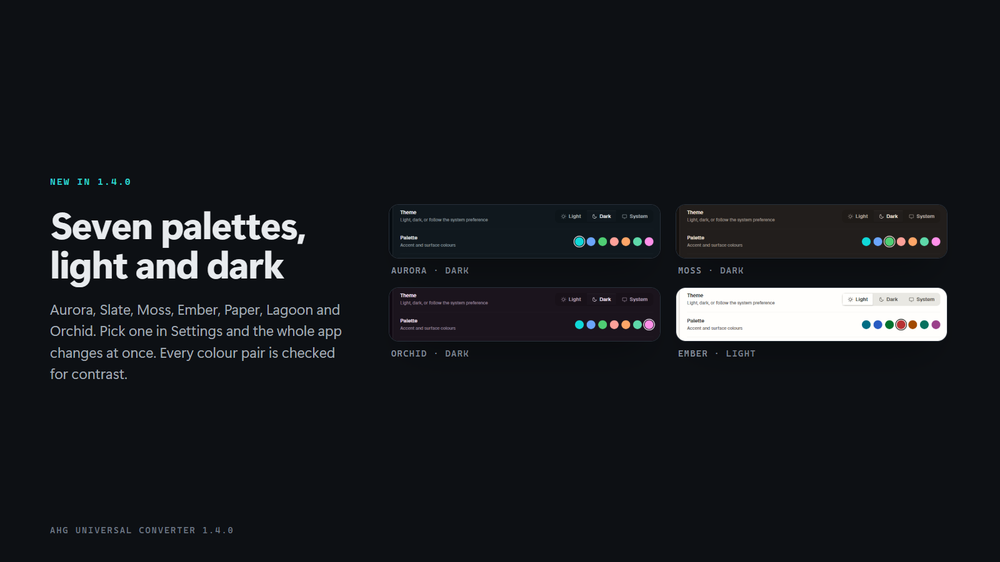
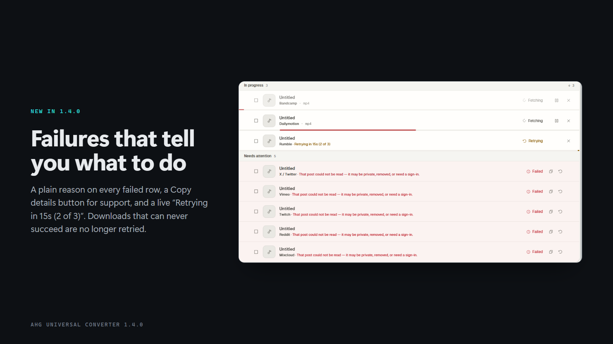

# AHG Universal Converter 1.4.0

**Fewer failures, clearer failures, and a lot more places to download from.**

## What's new

### Eight more sources
Paste a link from **X (Twitter), Vimeo, Twitch, Bandcamp, Reddit, Dailymotion, Mixcloud or Rumble** and the app recognises it straight away. Bandcamp albums and artists, Vimeo showcases and channels, Twitch videos and clips, Mixcloud users and Dailymotion playlists download as a collection.

### Seven colour palettes
Settings → Appearance now has **Aurora, Slate, Moss, Ember, Paper, Lagoon and Orchid**, each in light and dark. Pick one and the whole app changes live, with no flash on the next start. Every pair of colours was checked for readable contrast.

### Clearer failures
When a download fails you now see why, in plain words, and what to do next: private video, removed, age-restricted, sign-in needed, not available in your country, protected content, rate limited, no network, disk full. Failed rows have a **Copy details** button for support. Retrying rows say **"Retrying in 15s (2 of 3)"**. Things that can't succeed are no longer retried.

### Your own logged-in access
**Import cookies.txt** (Settings, Plus) lets downloads run as your own signed-in account, so private, members-only and age-gated videos you can already watch work.

### Live speed graph
While anything is downloading, the Dashboard shows a live **speed graph** and a pulsing status dot. It pauses when the window is hidden and stays still if you prefer reduced motion.

### Smoother, calmer motion
Progress bars glide, finished and failed badges pop in, buttons press, and loading placeholders shimmer. Everything honours your system's reduced-motion setting.

## Reliability and safety
- The app no longer repeats work on every progress tick, so busy queues stay light.
- History, stats, licence and settings are saved atomically, so a crash or power cut can't leave a half-written file.
- A small rotating log (`ahg.log`) records crashes and failures, with tokens and cookies removed.
- Folder, proxy and speed-limit settings are validated, and bad values are rejected with a reason.
- Updates only follow downloads that end on a trusted GitHub host, and must still match the published checksum.
- A cached licence stops working after 30 days offline.
- Bundled **yt-dlp updated to 2026.10.21**.
- Unused bot credentials were removed from the app.

## Not in this release
- **Bundled JS runtime for YouTube.** Skipped. YouTube works as before; some yt-dlp builds warn that a few formats may be missing.
- **Extra hardening of the app shell** (Electron fuses). Needs a newer build tool; planned for a later release.
- **Playlist item picking for YouTube.** The engine supports downloading chosen items, but there is no picker for it yet.
- **Icons for the eight new sources.** They have labels only for now.
- Bare Twitch channel links (live streams) are treated as single items, not collections.
- Known limits: the 30-day offline cap can be defeated by editing local files or the clock; cookies.txt files containing only HttpOnly cookies are rejected; a fresh install may flash the default palette for a moment on first launch.
